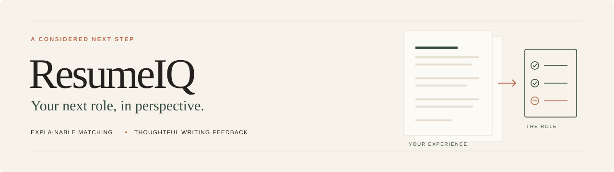
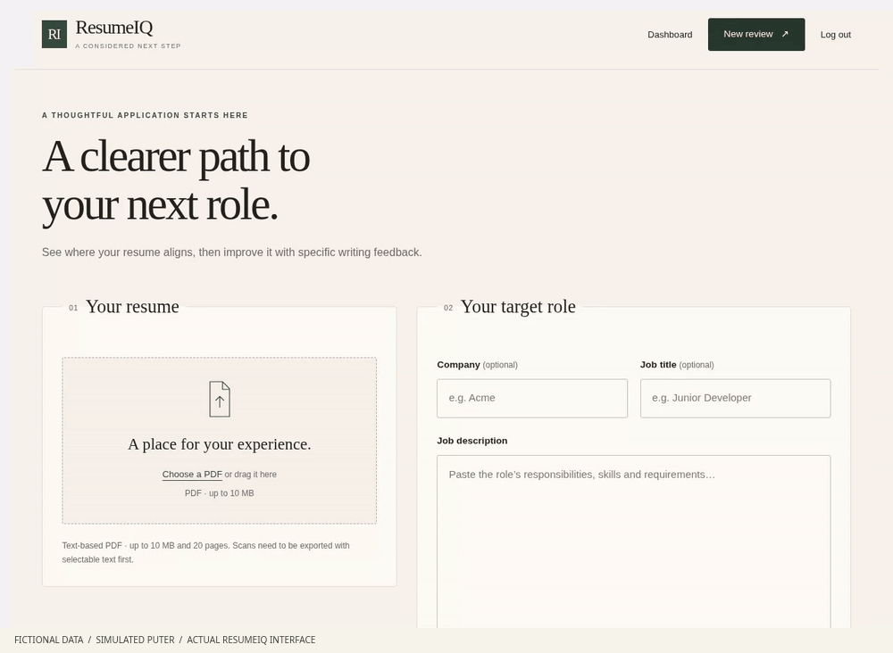
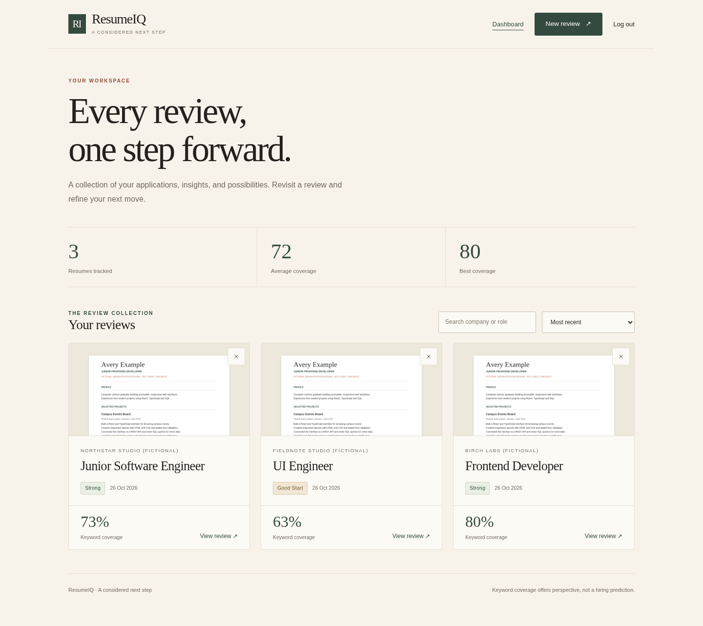
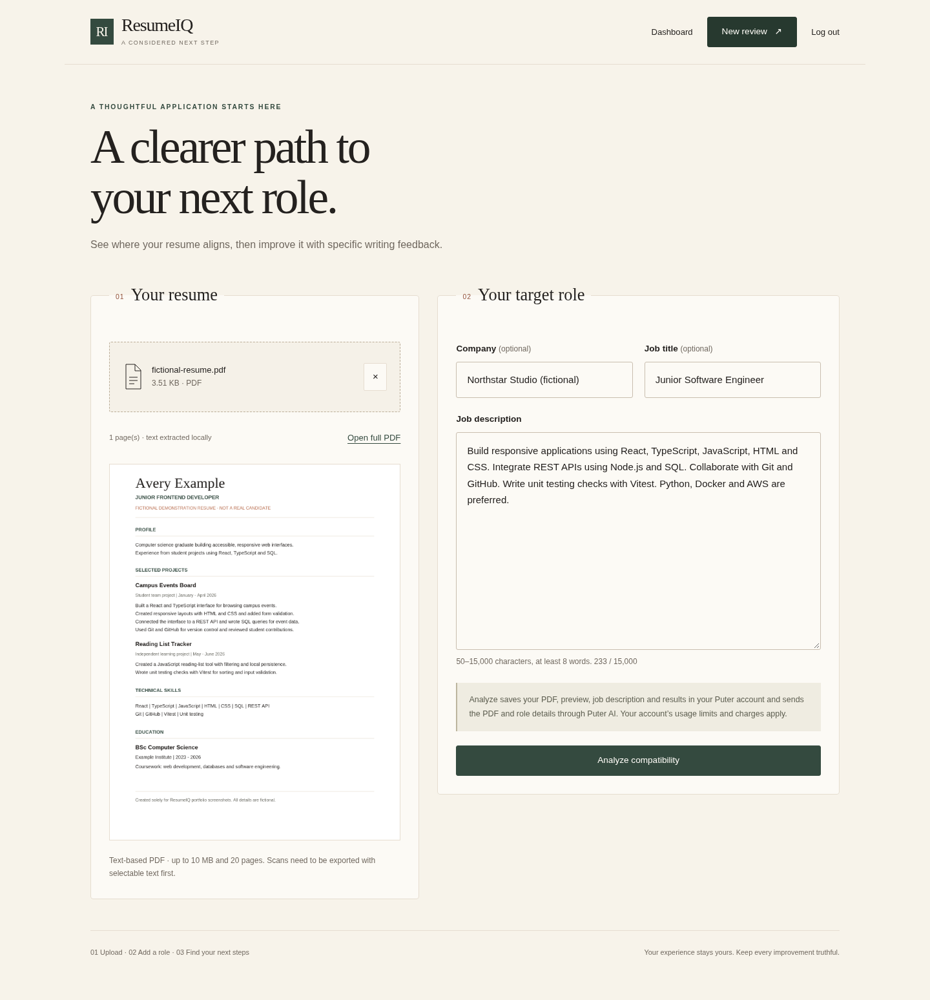
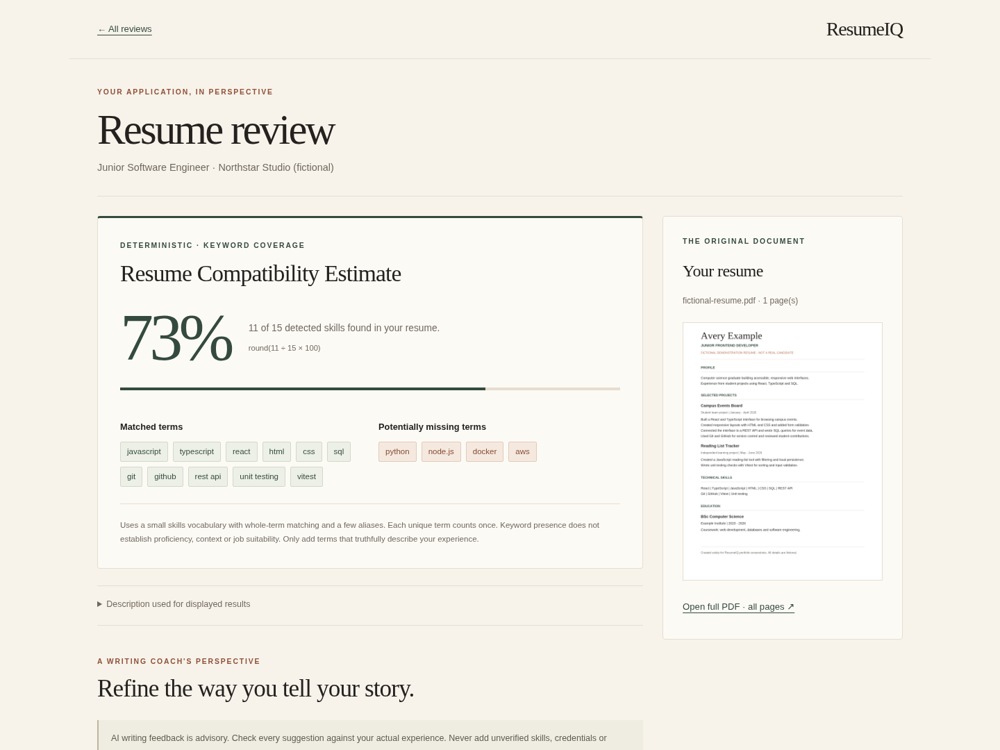
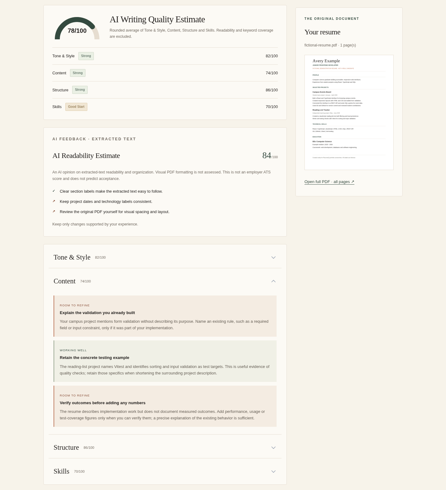
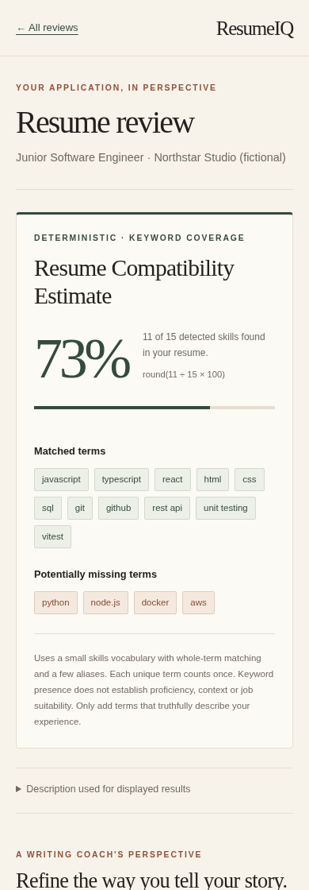
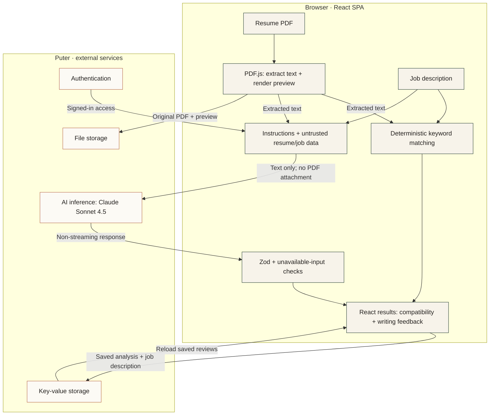

<p align="center">
  
</p>

<p align="center">
  <strong>Explainable job matching and thoughtful AI writing feedback for your next application.</strong>
</p>

<p align="center">
  <a href="#application-preview">Preview</a> ·
  <a href="#system-architecture">Architecture</a> ·
  <a href="#getting-started">Getting started</a> ·
  <a href="#testing-and-verification">Verification</a>
</p>

## Application Preview

<p align="center">
  
</p>

*Captured from the running application with fictional data and simulated Puter authentication, storage and AI replies. PDF.js extraction, keyword matching, validation and UI interactions run normally. The media demonstrates the interface; it is not authenticated provider evidence.*

| Your review collection | Resume and target role |
| :---: | :---: |
|  |  |
| Saved analyses, coverage summaries and search. | Local PDF preparation before analysis. |
| **Transparent compatibility** | **Separate writing feedback** |
|  |  |
| Inspect the denominator and matched/missing terms. | Review advisory ratings and explained suggestions. |

<p align="center">
  
</p>

<p align="center"><em>The same review, in the mobile layout.</em></p>

## Overview

ResumeIQ helps job seekers compare a resume with a particular role and improve how they describe their existing experience. Upload a text-based PDF, paste a job description, inspect the keyword coverage, then review AI writing suggestions.

The two assessments stay separate: **deterministic compatibility** explains which terms match, while **AI feedback** offers a subjective writing review. Neither is an employer ATS score or a hiring prediction. This portfolio MVP extends an existing React/Puter application; see [attribution](#attribution-and-license) for its provenance.

## Key Features

| Feature | What it does |
| --- | --- |
| **PDF preparation** | Validates PDF metadata, header, size, page count and readable text; extracts all pages and renders a first-page preview with a full-document link. |
| **Job-description matching** | Uses a small skills vocabulary, explicit aliases and whole-term matching, with a general-keyword fallback for other roles. |
| **Transparent coverage** | Shows `round(matched unique terms / detected unique terms × 100)`, the denominator and matched/potentially missing terms. No detected terms means no numeric score. |
| **AI writing review** | Reviews tone/style, content, structure, skills relevance and extracted-text readability through Puter AI. Instructions prohibit invented qualifications. |
| **Validated results** | Checks response shape/ranges with Zod and rejects explicit unavailable-document claims and known truncated output. AI failure retains the keyword result. |
| **Saved workspace** | Stores reviews in Puter, supports search/sort, per-review deletion, editable descriptions and manual reruns. |
| **Responsive interface** | Editorial typography, restrained color, stacked mobile layouts, reduced-motion support and visible error/pending states. |

AI writing quality is `round((toneAndStyle + content + structure + skills) / 4)`. Readability and deterministic keyword coverage do not contribute to that score.

## Tech Stack

| Technology | Responsibility |
| --- | --- |
| **React Router + React** | Framework-mode SPA, navigation, forms and results UI; no custom application server. |
| **TypeScript** | Strict types across routes, provider boundaries and saved records. |
| **Tailwind CSS** | Shared styling and the Editorial & Elegant visual language. |
| **Zustand** | Client state and the Puter SDK wrapper. |
| **PDF.js** | Browser-based text extraction and PDF preview rendering. |
| **Zod** | Runtime feedback validation, inferred types and the prompt's generated JSON Schema. |
| **Puter** | External authentication, file storage, key-value storage and AI access. |
| **Puter AI · Claude Sonnet 4.5** | Extracted-text writing feedback via `claude-sonnet-4.5`. |
| **Vitest** | Offline regression tests for matching, validation, PDF boundaries and the review lifecycle. |

## System Architecture



The original PDF and preview remain in Puter storage. **The AI request receives extracted text, not the PDF attachment.** Text is not separately persisted; manual reruns extract it again from the stored PDF. There is no custom backend, database or vector service.

## Getting Started

Use **Node.js 24.x** and npm. Internet access, Puter sign-in and sufficient account allowance are required for cloud features. No `.env` or application API key is required. AI usage may incur charges for the signed-in user.

```bash
git clone https://github.com/TheQuantumPanda/resumeiq.git
cd resumeiq
npm ci
npm run dev
```

Open the URL printed by Vite, normally `http://localhost:5173`. Sign in through Puter, choose **New review**, select a text-based PDF and paste the job description.

```bash
npm run build
npm start
```

The static output is `build/client`; `npm start` previews it locally, normally on port 4173. A static host needs HTTPS and an `index.html` fallback for application routes. `public/_redirects` supports compatible hosts; verify Puter permissions on the eventual origin.

### Vercel static hosting

Import `TheQuantumPanda/resumeiq` with the repository root as the Root Directory and these settings:

| Setting | Value |
| --- | --- |
| Framework Preset | **Other** (`framework: null`) |
| Node.js Version | **24.x** |
| Install Command | `npm ci` |
| Build Command | `npm run build` |
| Output Directory | `build/client` |
| Environment Variables | None required |

[vercel.json](vercel.json) fixes the static build settings and supplies one SPA fallback for direct links and refreshes. Existing files take precedence over the rewrite. `ssr: false` remains unchanged; only `build/client` is published, with no Vercel Functions or custom server. Puter loads over HTTPS and the bundled PDF.js worker is served from `/assets/`. After deployment, verify sign-in permissions, saved-review reloads and PDF preparation on the final origin; local checks do not establish those hosted behaviors.

## Testing and Verification

| Command | Scope |
| --- | --- |
| `npm test` | **129 passing tests across 8 files**, verified locally on 26 October 2026. Covers scoring boundaries, validation, text-only AI requests, truncation, saved invalid feedback and manual failure recovery. |
| `npm run typecheck` | Generates route types and runs strict TypeScript checking. |
| `npm run lint` | Runs ESLint across application and configuration code. |
| `npm run build` | Produces the static SPA. |

Tests use mocked PDF/provider boundaries and make no authenticated inference calls. **Real authenticated, resume-specific Puter AI analysis is user-verified**, separately from automated checks. That does not establish account isolation, provider availability or behavior on a future hosted origin. The preview media above uses simulated Puter replies.

## Known Limitations

- **Text-based PDFs:** up to 10 MB and 20 pages; no OCR. Scans need a selectable-text export. PDF reading order or hidden text may distort extraction.
- **Bounded AI input:** resume text is limited to 30,000 characters without silent truncation. Requests are non-streaming, with a 4,096-token output cap and a 90-second client deadline. Known truncation fails safely.
- **Approximate matching:** the skills vocabulary is small and English-focused. General keywords are crude; negation, proficiency and years of experience are not understood. Keyword presence is not suitability.
- **Advisory AI:** validation does not establish factual accuracy. Verify every suggestion and never add invented qualifications. AI readability concerns extracted text, not fonts, margins or visual PDF formatting.
- **External services:** Puter permissions, availability, quotas and charges apply. Retries are manual; a timed-out request may still consume allowance. Failed file cleanup after deletion may require manual removal in Puter.
- **Data handling:** Analyze uploads the PDF/preview and saves the job description/results in Puter; extracted text and role details pass through Puter AI to its model provider. Use fictional documents for demonstrations. See [Puter security](https://docs.puter.com/security/) and [AI documentation](https://docs.puter.com/AI/chat/).

## Attribution and License

ResumeIQ started from [**ResuMetrics by Ayush Yadav**](https://github.com/ayushYadav1107/ResuMetrics), retaining useful React/Puter integration and feedback components. The original [MIT license](LICENSE), including **Copyright (c) 2026 Ayush Yadav**, is preserved unchanged.

The inherited implementation also shares code with [**JavaScript Mastery's AI Resume Analyzer**](https://github.com/adrianhajdin/ai-resume-analyzer). Its tutorial provenance is acknowledged; redistribution permission for tutorial-derived portions remains unconfirmed. The ResuMetrics MIT notice and attribution do not establish that separate permission.

ResumeIQ-specific work includes deterministic job matching and transparent coverage, all-page text extraction, text-only AI requests, unavailable-document safeguards, stronger failure recovery, an editorial interface and expanded regression tests. The project is an adaptation, not a claim that all underlying code is original.
